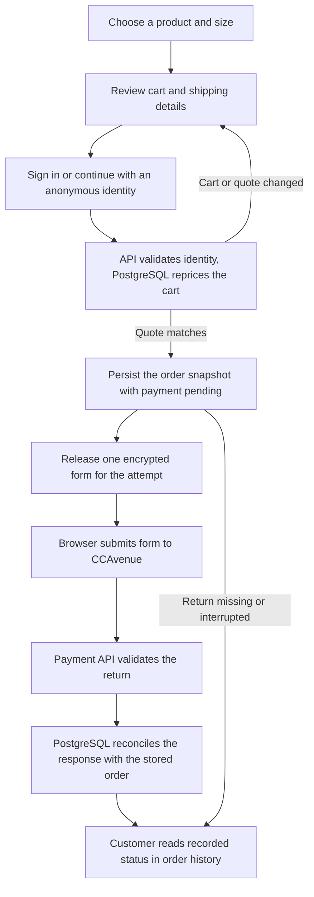
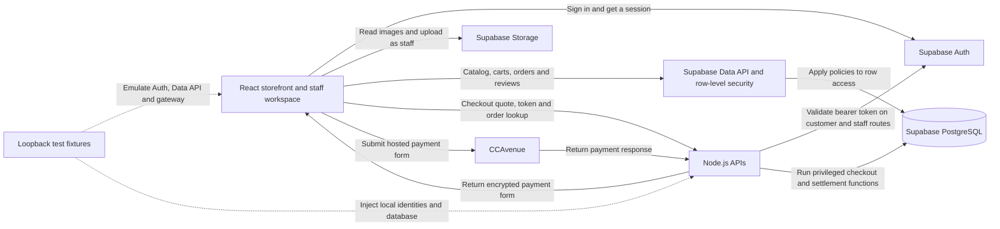

# GCMT Shop — Full-Stack Ecommerce and Order Management

GCMT Shop is a React storefront and staff workspace for GCMT Herbal. Customers can browse products, choose sizes, manage a cart and follow their orders. Staff manage the catalog, product images, order fulfilment, enquiries and newsletter subscriptions.

The central engineering problem is keeping the cart a customer reviewed, their authenticated identity, the amount charged by the gateway and the stored order in agreement. The checkout API and PostgreSQL enforce that relationship from quote through settlement, including when a browser disconnects or a gateway response arrives twice.

## What the application does

| Area | Capabilities in this source |
| --- | --- |
| Product discovery | Search and filter the catalog, open product details and select an available size where a product offers one. |
| Carts | Keep a guest basket in the browser, then merge its items into the cart associated with a Supabase identity. |
| Checkout | Reprice the cart on the server and prepare a CCAvenue payment or a cash-on-delivery (COD) order when that method is enabled. |
| Order history | View recorded payment and fulfilment status and download a PDF invoice for eligible records. |
| Staff operations | Maintain products and images, update and archive orders, and record cash collection for eligible COD orders. |
| Reviews and communications | Submit and manage product reviews, send enquiries and join the newsletter. Staff can review enquiries and subscriptions and export them as CSV. |

## Run locally

Use Node.js 24.15 or later in the 24.x line and npm 11.9.0, the version pinned for CI. From the repository root, run:

```bash
npm ci
npm run review
```

Open <http://127.0.0.1:4173>. The preview builds the React app and serves it with synthetic accounts, products and orders backed by an isolated, in-memory PostgreSQL database (PGlite). Both checkout methods are disabled in this mode. Setup requires no Supabase project, merchant account or credentials.

Press **Ctrl+C** to stop the preview. Run `npm run review` again after source changes to rebuild the app and reset the sample data. For connected development, see [deployment and staging](docs/deployment.md#rehearse-in-staging).

## Follow a customer order



An online order exists before the browser leaves for CCAvenue. Its snapshot preserves the agreed line items, total and reference for reconciliation. While that order is pending, the customer can read its stored status without creating a second payment attempt.

- If a price, size or availability changes, checkout asks the customer to review the cart again, even if its total is the same.
- If the browser loses the response after the form has been released, checkout returns the existing unresolved reference and withholds a second form. The same identity can check order history while the gateway result is reconciled.
- If the gateway repeats an accepted response, the database recognizes the stored receipt and leaves the purchased cart quantities alone.
- If any part of settlement fails to persist, PostgreSQL rolls back the receipt, payment state and related cart changes together. A later valid response can retry reconciliation.

[Checkout handler](server/checkout.js) · [Callback handler](server/payment.js) · [Payment lifecycle and recovery](docs/payment-lifecycle.md)

## Architecture



React handles browsing, cart interaction and presentation. For direct browser queries, grants and row-level security (RLS) constrain what the current Supabase identity can access. The Node.js API validates that identity for private routes and derives the owner from the session. Its service client can bypass RLS, so explicit owner and staff checks matter on that path. Merchant credentials and privileged database settings stay on the server.

| Technology | Role |
| --- | --- |
| React, React Router and Vite | Render the storefront and staff screens, handle navigation and build the frontend. |
| Supabase Auth, PostgreSQL and Storage | Issue identities, enforce data access and persist business records and product images. |
| Node.js and CCAvenue | Prepare encrypted gateway requests, validate callbacks and return stored order status. |
| Vitest, Playwright, PGlite and native PostgreSQL | Test handlers, browser flows, SQL policies and concurrent transactions with local fixtures. |

The database calculates prices in paise from the current catalog and compares the entire quote before releasing a form. Persisting that quote ties the eventual payment to the original purchase even when catalog prices change. Settlement groups the receipt, order state and cart reconciliation in one transaction so they cannot disagree after a partial failure. Order lookup uses the recorded owner even when a customer has the payment reference.

## Data model and payment logic

Supabase Auth identities map to entries in `public.users`. Products carry prices, discounts and available sizes. Cart rows track owner, product, selected variant and quantity. Orders keep a line-item snapshot so history can display the agreed quantities and prices. Product reviews, contact enquiries and newsletter subscriptions have their own tables. Gateway receipts, response events and staff cash collection actions are stored in the private schema.

`open_store_checkout` locks the customer's checkout and compares the quote with the current basket. `record_store_response` binds the callback to the stored gateway reference and passes the payment evidence to the settlement function. Unique references, row locks and atomic writes protect retries and concurrent requests. COD uses the same pricing checks and records an unpaid order. `collect_store_cod` records the staff actor and receipt when cash is collected.

[Schema bootstrap](supabase/bootstrap/empty-project.sql) · [Checkout migration](supabase/migrations/20261122174027_checkout_integrity.sql) · [Access policies](supabase/migrations/20261030203438_production_security.sql)

## Testing

The local results below were verified on November 23, 2026 with Node.js 24.22.2 and npm 11.19.1.

Install Chromium with `npx playwright install chromium` before running the browser suite. On Linux CI, the workflow uses `npx playwright install --with-deps chromium` to install the system dependencies as well. Stop the preview first so port 4173 is free.

| Command | What it verifies | Local result |
| --- | --- | --- |
| `npm test` | Handler behavior, SQL policies via PGlite, access control and component behavior | 49 passed |
| `npm run test:postgres` | Native PostgreSQL races, callback retries and transaction rollback | 15 passed |
| `npm run test:e2e` | Storefront flows, account isolation, checkout recovery and simulated gateway responses | 15 passed |
| `npm run build` | Vite production bundle | Passed |

`npm run check` combines the source secret scan, Vitest, native PostgreSQL tests, build and runtime dependency audit. The browser tests use an isolated identity service, synthetic records and a payment simulator. [Verification workflow](.github/workflows/verify.yml) · [Test evidence](docs/engineering-audit.md)

## Current status and limitations

The checked-in checkout flow was verified locally against synthetic services. The commercial storefront used an earlier payment integration when it was inspected on November 23, 2026. The simulator verifies application behavior under controlled responses. Merchant acceptance, hosted schema compatibility and the production cutover still require separate staging validation. [Deployment and recovery](docs/deployment.md)

## Project structure and documentation

```text
src/                  Storefront, customer account and staff screens
api/                  Same-origin HTTP entry points
server/               Checkout, order lookup and payment handlers
shared/               Gateway settings shared by browser and server
supabase/             Database bootstrap, migrations and local configuration
scripts/              Local preview and verification commands
tests/                Handler, database and browser regression suites
docs/                 Technical guides, review evidence and deployment notes
```

- [Checkout and payment lifecycle](docs/payment-lifecycle.md)
- [Database and security review](docs/engineering-audit.md)
- [Technical questions and answers](docs/engineering-questions.md)
- [Testing and verification](#testing)
- [Deployment, staging and recovery](docs/deployment.md)

## Attribution

Application development by Ved Patel and the contributors recorded in Git history. GCMT Herbal branding and commercial product imagery belong to Gold Coin Multi-Trade Private Limited or their respective rights holders. Third-party libraries retain their own licenses.
