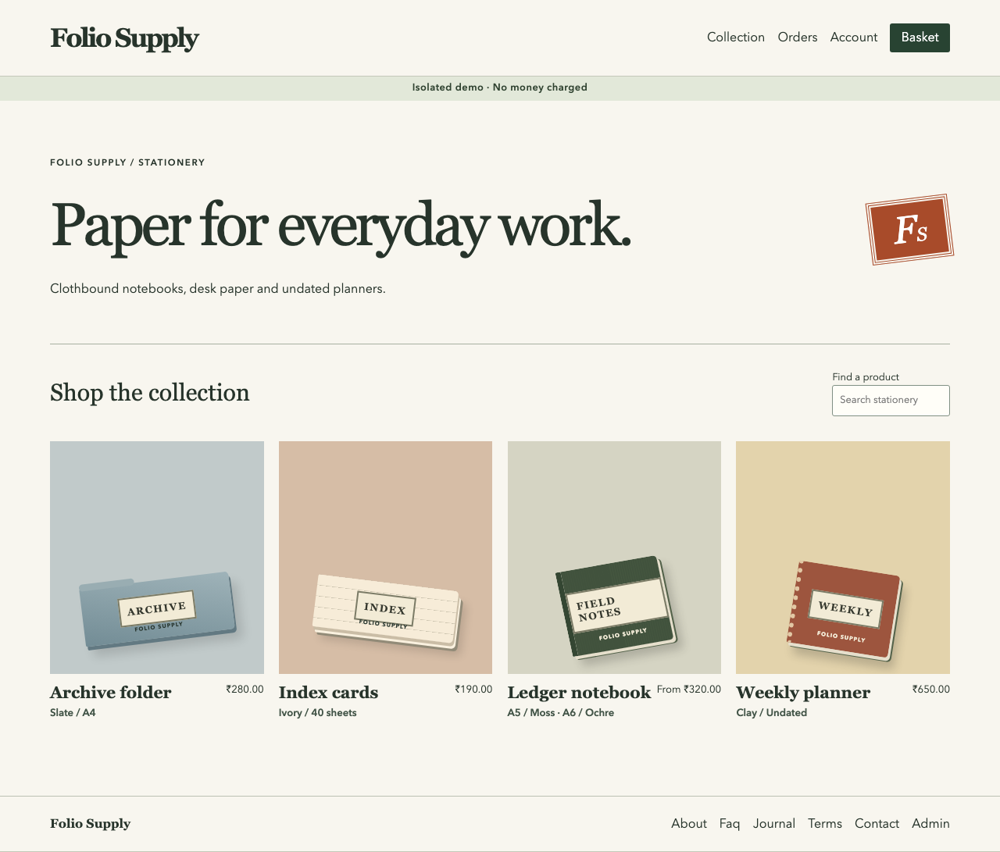
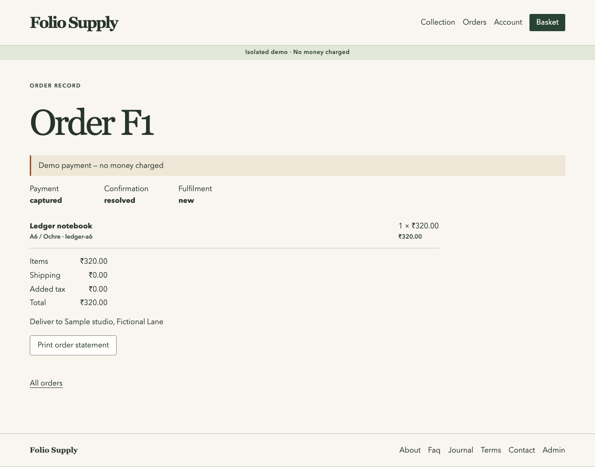
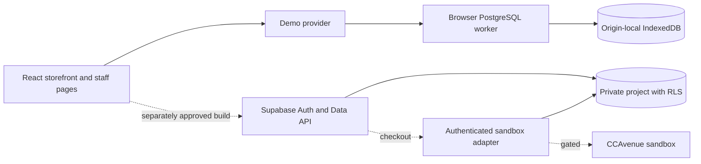
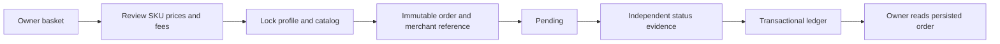

# Folio Supply

**Isolated demo · INR · No money charged.** A stationery shop that runs checkout transactions, order history and staff workflows in PostgreSQL inside your browser. The separate merchant sandbox adapter is release-gated.



## Run locally

Use Node 24 and npm. From the repository root:

```sh
npm ci
npm run dev
```

Open the loopback URL printed by Vite in a modern browser with IndexedDB, Web Locks, Web Workers and WebAssembly. No environment file or account is required. The first visit downloads the PostgreSQL engine and seeds five editions. For a production-build preview, use `npm run build` and `npm run preview`. The public application has no merchant network transport.

| Area                  | Try it                                                                                                                                                 |
| --------------------- | ------------------------------------------------------------------------------------------------------------------------------------------------------ |
| Collection            | Search paper goods, choose an edition and quantity, compare availability and price.                                                                    |
| Basket                | Add from two tabs, open a customer profile, review the quote and create one resumable order.                                                           |
| Order record          | Try a pending, declined, cancelled or captured **local scenario**. Reload the order, open history and print its itemized statement.                    |
| Studio administration | Select the synthetic staff profile in Account. Edit prices and availability, manage edition images, moderate reviews and handle consented submissions. |
| Operations            | Advance fulfilment, document COD collection, archive records and request refund review. Inspect pending payments and the event journal.                |



## Application and trust boundaries





React 19.3.1, Vite 8.3.6 and PGlite 0.5.13 power the demo. Both providers use the same SQL migrations. Separate-connection tests use PostgreSQL 18.7. Browser checks use Playwright 1.65.1. Exact dependencies are pinned in the lockfile.

| Path                                    | Responsibility                                                                  |
| --------------------------------------- | ------------------------------------------------------------------------------- |
| `src/pages`, `src/ui.jsx`               | Customer and staff screens, edition art, accessibility and printable statements |
| `src/demo`, `src/staging`               | Origin-local simulator and explicitly bound hosted provider                     |
| `supabase/migrations`                   | Roles, cart and order constraints, snapshots, media and journals                |
| `server`, `api`                         | Sandbox contracts, verified evidence, request validation and public disablement |
| `tests`, `scripts`, `.github/workflows` | Real database and browser checks, built-artifact checks and CI                  |
| `docs`                                  | Operating procedures, verification evidence and design decisions                |

## Verify

```sh
npm run format:check
npm run lint
npm test
npm run build
npm run check:secrets
npm audit --audit-level=moderate
npx playwright install chromium
npm run test:e2e
```

The database suite creates and stops a disposable loopback cluster. Precise results, browser dimensions and coverage limits appear in the [QA report](docs/verification/05-qa-results.md).

## Deployment and attribution

The default build serves an isolated demonstration. Staff selection is a local test convenience. Hosted privileges come from private database memberships and RLS. Service credentials belong exclusively on a separately approved server. Merchant authentication, current integration kit, status inquiry, hosted Auth and business policies require independent sign-off. The personal repository has no automatic Vercel Git deployment configured in its new source.

The application, stationery illustrations, fixtures and documentation in this revision were independently implemented against a functional specification. Commercial product photography, customer records, logos and source files were excluded. No new license grant is asserted. Historical commits retain their original provenance.

[Architecture](docs/architecture.md) · [Payments](docs/checkout-and-payments.md) · [Database](docs/database-and-security.md) · [Demo](docs/demo-mode.md) · [Testing](docs/testing.md) · [Deployment](docs/deployment.md) · [Operations](docs/operations.md) · [Release gates](docs/verification/07-release-gates.md)
