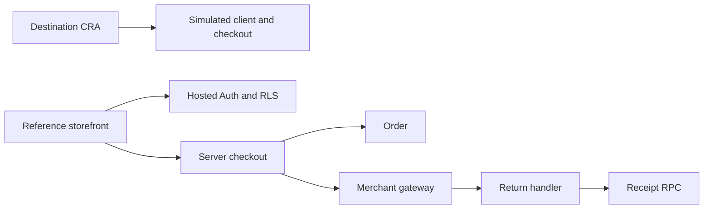
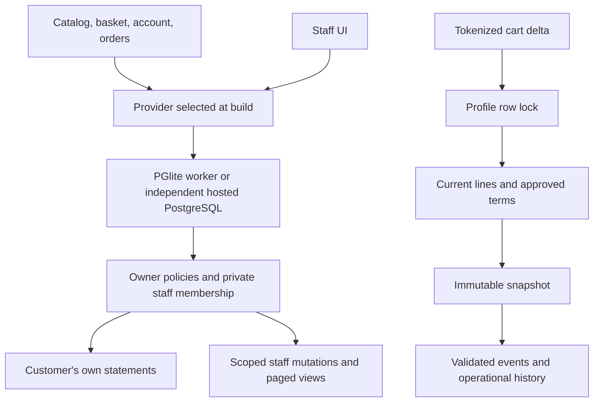

# Architecture

The former destination rendered React pages against an in-browser Supabase imitation. The commercial reference used separate Vercel handlers, a hosted database and a browser return endpoint.

The destination now has one Vite application. Its build-time provider alias resolves to either the browser database or an explicitly reviewed staging binding. The default artifact excludes the hosted provider and all merchant code. The role simulation is intentionally observable in the browser. A staff selection in the demo grants no hosted privilege.

Public art is authored in CSS. Uploaded media is decoded and normalized. A maximum of four ordered images per edition are stored as bounded WebP bytes in PostgreSQL. This design avoids a second write to an object bucket and abandoned objects after failed catalog edits. Large external media libraries need a separately reviewed storage design.
