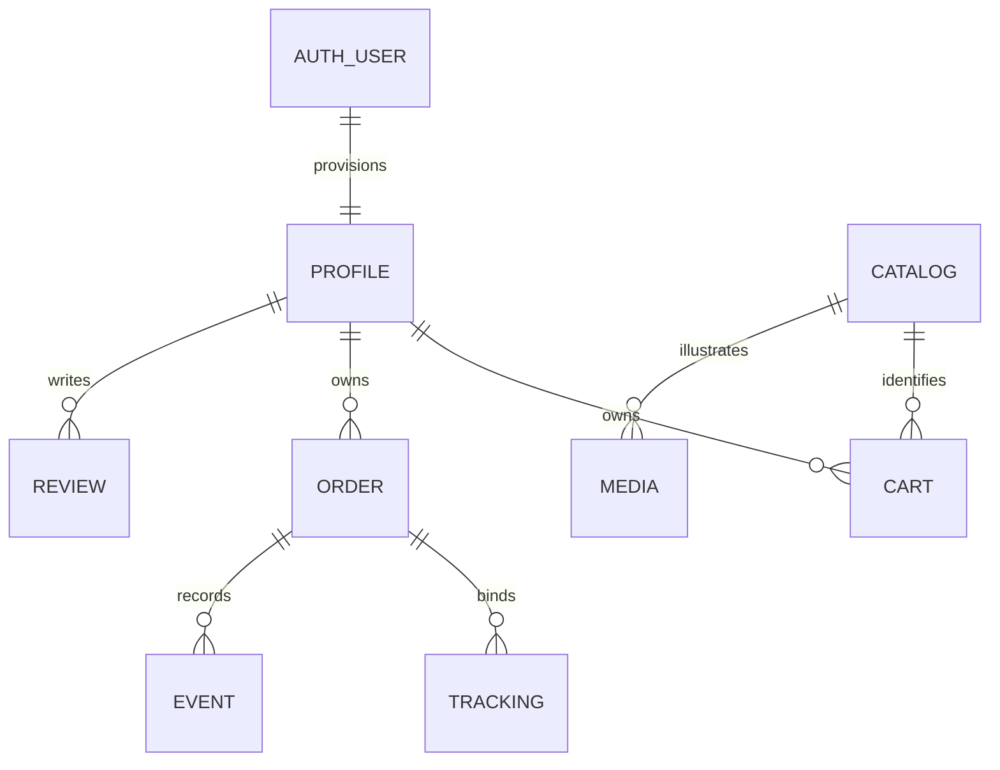

# Database and security

Apply numbered migrations in order to a fresh isolated project. Hosted Supabase supplies auth.users, auth.uid(), anon, authenticated and service_role. The test bootstrap supplies disposable equivalents. The first migration creates a dedicated folio schema, membership table, profile provisioning trigger and explicit grants. A name collision fails the migration.

| Actor                        | Reads                                                             | Writes                                                                                                              |
| ---------------------------- | ----------------------------------------------------------------- | ------------------------------------------------------------------------------------------------------------------- |
| Public                       | Catalog, fee terms, edition images, published reviews             | Bounded submission handler only                                                                                     |
| Authenticated guest/customer | Own profile, basket, orders and destination                       | Own label, atomic cart deltas, one moderated review per edition                                                     |
| Staff                        | Paged orders, events, exceptions, inbox, catalog and review queue | Scoped catalog updates, moderation, consented-record deletion, fulfilment, COD, archival and refund review requests |
| Trusted services             | Narrow order projection and validated identity                    | Quote-checked order creation, one-time handoff, bound evidence, throttled submissions and image replacement         |
| Database operator            | Migration and recovery access                                     | Staff provisioning and signed-off fee policy                                                                        |

A role in user-editable metadata has no authority. The hosted client carries only a publishable key. SECURITY DEFINER functions have explicit search paths and grants. No ordinary role can delete orders or alter financial snapshots. Append-only events retain timestamps, actor and operator notes. Order and event triggers also protect against accidental operator DML. Trusted administrative schema changes still require operational controls.

Content is rendered as React text. Uploaded image bytes are decoded, dimension-limited and re-encoded before entering the hosted store. Public reads return normalized content only. Demo art is synthetic. Staff inbox projections are access-controlled; personal messages are never included in CI. An operator must approve retention before accepting actual submissions.
