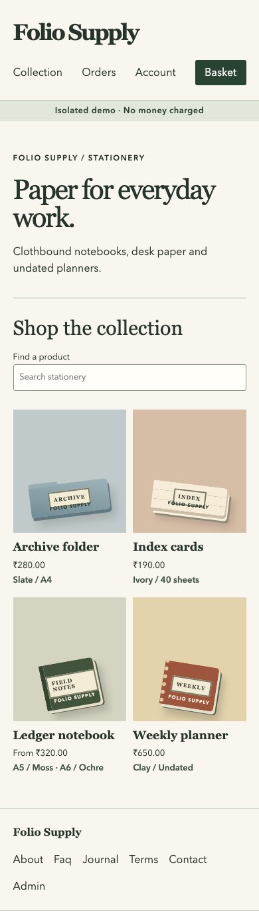

# Isolated demo

Visit the collection, choose an edition and add it to the basket. Guest edits use Web Locks between tabs. Checkout creates a synthetic local guest profile and merges the cart with a replayable token. Opening the customer profile preserves this browser's guest orders. Opening the separate staff profile exposes only this browser's synthetic database.

Choose an online scenario to exercise pending, declined, cancelled and captured events. The order page always displays database state. Select COD to exercise packing, shipping, delivery and documented collection in the staff view. Refund review records a request. The application never submits a real payment, refund or email.

Browser persistence requires a secure origin or loopback, WebAssembly, Web Locks and IndexedDB. Order statements can be printed or saved as PDF using the browser. To reset all local fixtures, close other shop tabs and clear this origin's site data, then reopen it. This resets every local profile, order, upload and message. Use fictional details only.

